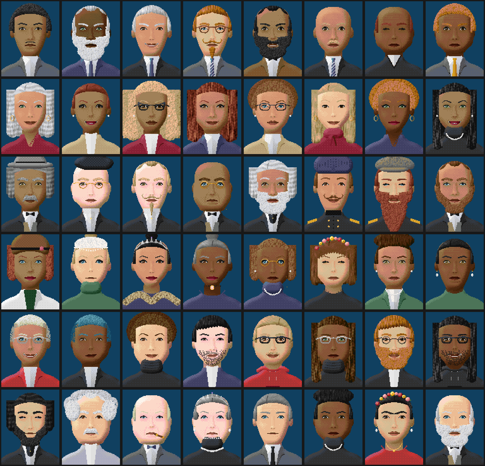

# Modern Tycoon CEO faces

Six new company manager face styles, drawn by a script instead of by hand:

| Style label | What it is |
|---|---|
| `modern/executive_m` | Modern executive: suits, beards, turbans, glasses |
| `modern/executive_f` | Modern executive: blazers, long and natural hair, hijab, jewellery |
| `modern/tycoon` | 19th-century industrialist: frock coats, top hats, mutton chops, monocles |
| `modern/lady` | Lady of industry, 1850s–1920s: updos, hats, tiaras, pearls, mourning dress |
| `modern/founder` | Tech founder: hoodies, turtlenecks, dyed hair, headphones |
| `modern/figures` | 16 finished look-alikes of historic figures (Brunel, Lincoln, Einstein, Tesla, Edison, Carnegie, Queen Victoria, Marie Curie, Churchill, Darwin, Frida Kahlo, Steve Jobs, Coco Chanel, Henry Ford, Madam C. J. Walker, Napoleon) |

Skin tone, hair colour, eye colour and outfit colour are recolour palettes, so
one hair sprite works in every colour. Eight skin tones run from porcelain to
deep brown. Each style fits in the 32 face bits, so savegames, the network
command and face codes are unchanged.



## How it works

- `tools/parts.py` draws each part (head, eyes, brows, nose, mouth, hair, facial
  hair, outfits, glasses, headwear, jewellery) at 4x size with simple lighting,
  then `tools/raster.py` shrinks it to the 92x119 face frame with an ordered dither.
- Recolourable parts use "label" palette ramps (`tools/materials.py`); the game
  swaps them through recolour sprites (`FaceVarType::Recolour`).
- `tools/build_faces.py` defines the styles and writes:
  - `media/baseset/mt_faces.grf`: all sprites and recolour palettes, loaded at
    `SPR_MT_FACES_BASE` by `gfxinit.cpp`;
  - `src/table/mt_company_face.h`: the generated face tables;
  - `generated/contact_sheet.png`: random faces for review.
- `FaceVar::rarity` makes hats, glasses and the like less common on random faces.

## Rebuild

```bash
python3 -m venv ~/src/.venv-faces && ~/src/.venv-faces/bin/pip install numpy pillow
~/src/.venv-faces/bin/python extensions/ceo_faces/tools/build_faces.py
```

If the sprite count changes, update `MT_FACES_SPRITE_COUNT` in
`src/table/sprites.h`; the generated header has a `static_assert` that catches it.
