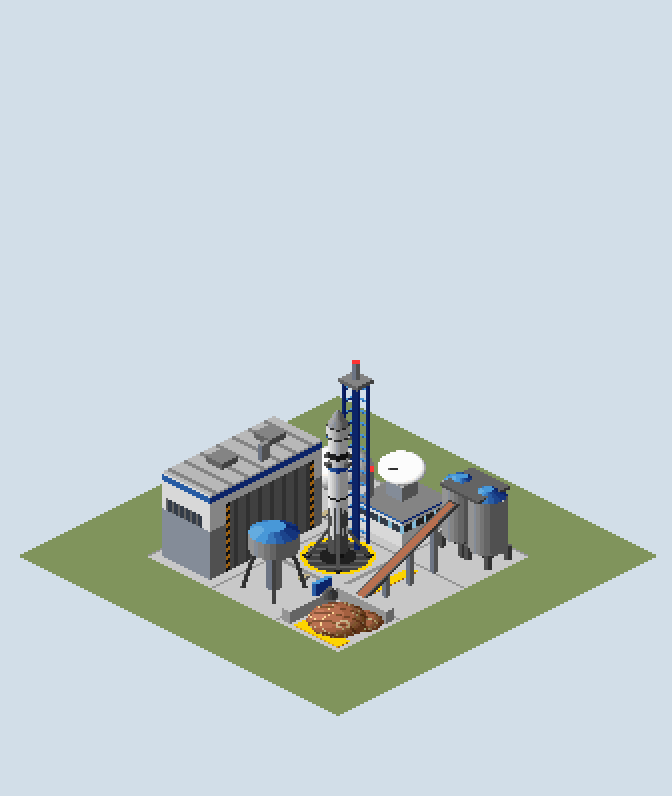
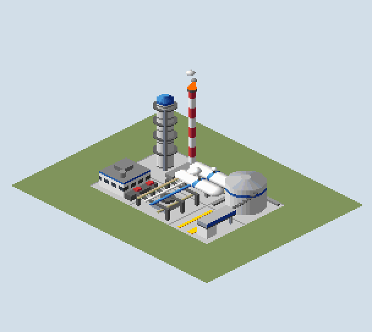
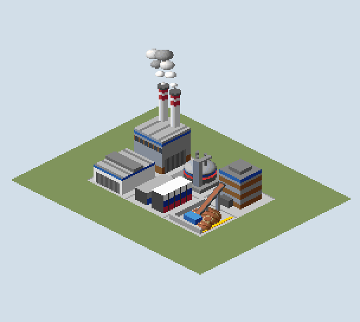

# Modern Tycoon Space Industry

A new industry chain as an ordinary NewGRF (GRF ID `MTSI`): oil becomes rocket
fuel, the spaceport launches rockets to the asteroid belt and lands them again
full of asteroid ore, and the refinery turns the ore into goods. Development
preview: it works in game, but it is not release art yet (see "Not done").



## The chain

```text
Oil wells --oil--> Rocket Fuel Plant --rocket fuel--> Spaceport --asteroid ore--> Asteroid Refinery --goods--> towns
```

| Industry (English / Norwegian) | Size | Accepts | Produces |
| --- | --- | --- | --- |
| Rocket Fuel Plant / Rakettdrivstoffverk | 2 x 3 | Oil | Rocket Fuel, 1 per unit of oil |
| Spaceport / Romhavn | 3 x 3 | Rocket Fuel | Asteroid Ore, 1 t per unit of fuel, plus a small output of its own (about 35 t a month) so a new spaceport is never idle |
| Asteroid Refinery / Asteroideraffineri | 2 x 3 | Asteroid Ore | Goods, 1 per tonne of ore |

New cargos: **Rocket Fuel** (`RFUL`, liquid) and **Asteroid Ore** (`AORE`, bulk,
pays more than iron ore). No new vehicles are needed: OpenTTD lets oil tankers
carry any liquid cargo and coal/ore wagons and trucks carry any bulk cargo, so
the default vehicles move both (the test checks this). Tinde bulk hoppers from
Modern Tycoon Trains also carry asteroid ore. Not available in toyland.

## Animation

- **Spaceport pad** (240 frames, about 13 s): fuelling with venting vapour and the
  service arm attached, ignition with a growing exhaust cloud, lift-off with the
  legs folding and a smoke trail, an empty pad while the trail drifts away, then
  the returning rocket (sooty, with its pod full of ore) comes down on a blue
  retro burn, deploys its legs, kicks up dust, lands and opens the pod hatch.
- **Mission control**: the tracking dish turns.
- **Rocket Fuel Plant**: flickering flare on the stack, cold vapour from the tank vents.
- **Asteroid Refinery**: smoke from both chimneys, pulsing arc-furnace glow with sparks.

All animated pixels stay inside the screen box OpenTTD repaints for a tile
(32 px each side, 200 px up), so nothing leaves stale pixels behind.

| Rocket Fuel Plant | Asteroid Refinery |
| --- | --- |
|  |  |

## How the art is made

Every pixel comes from code in this folder, like the vehicle pack:

- `art/source/*.py`: each industry as one small 3D model of boxes, cylinders,
  cones and spheres in industry coordinates (16 units per tile), plus the animation timelines.
- `tools/render3d.py`: casts a ray per pixel with OpenTTD's own projection, shades
  with the base set's upper-left light and maps to the DOS palette (the vehicle
  pack's `tools/palette.py`). A building spanning tiles is modelled once and cut
  per tile. Company-colour areas become each industry's random colour in game.
- `tools/build_pack.py`: renders every tile for every animation frame, keeps one
  copy of each distinct sprite and layout, writes the NML and the preview images
  (a still of each industry and a GIF of the spaceport cycle in game time).

## Build

```sh
python3 -m venv ~/src/.venv-nml && ~/src/.venv-nml/bin/pip install nml pillow pyyaml
extensions/modern_tycoon_industries/build.sh               # -> generated/modern_tycoon_space.grf (about 2 minutes)
extensions/modern_tycoon_industries/build.sh --update-docs # also refreshes the preview images in docs
```

`generated/` is disposable and git-ignored.

## Test

```sh
OPENTTD_BIN=build/openttd extensions/modern_tycoon_industries/test/ingame_test.sh
```

Runs a headless 1990 temperate game in a throw-away profile. The test
GameScript (`test/gs`) checks both cargos exist, builds all three industries,
checks each accepts its input, lists vehicles that refit to the new cargos and
waits for the spaceport to produce ore. The game is saved and reloaded and the
industries must still be there.

To play: copy `generated/modern_tycoon_space.grf` into the `newgrf` folder of
your profile, enable it in the NewGRF settings of a new game, and fund a
Spaceport from the industry window (Rocket Fuel Plants and Asteroid Refineries
also appear on new maps).

## Not done

- Visual check inside the game window: the headless driver cannot take
  screenshots, so placement is checked with the preview images, which put the
  sprites together with the game's offsets and draw order.
- The launch cycle loops on its own; it is not tied to actual fuel deliveries yet
  (a production callback could launch only when fuel is stocked).
- Snow and desert variants, construction stages, sounds, 32bpp and 2x/4x zoom.
- Human provenance review of procedurally drawn art (see VISUAL_DIRECTION.md).
- GRF ID and cargo labels not yet checked against the public registries.

SPDX-License-Identifier: GPL-2.0-only
