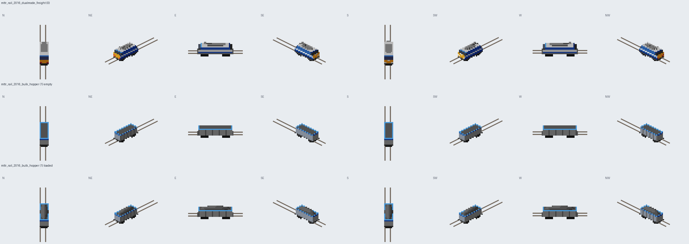

# Modern Tycoon Trains

The first original vehicles of Modern Tycoon, as an ordinary NewGRF
(GRF ID `MTTR`). Development preview: it works in game, but it is not
release art yet (see "Not done").



## Vehicles

| ID | Name (English / Norwegian) | Type | Intro | Key stats |
| --- | --- | --- | --- | --- |
| 0 `mttr_rail_2016_dualmode_freight` | Tinde DM6 Dual-Mode / Tinde DM6 tomodus | Freight locomotive | 2016 | 3,200 kW, 120 km/h, 90 t, runs on normal and electrified track |
| 1 `mttr_rail_2016_bulk_hopper` | Tinde Bulk Hopper / Tinde bulkvogn | Open bulk wagon | 2015 | 40 units, 120 km/h, refits to any bulk cargo; empty and loaded sprites |

Both are fictional designs based on contemporary archetypes. The data lives in
[`data/trains.yaml`](data/trains.yaml); the NML is generated from it.

## How the art is made

Every pixel comes from code in this folder:

- `art/source/trains/*.py`: the vehicles as small 3D models (boxes and heaps with paint rules).
- `tools/render.py`: projects a model with OpenTTD's isometric formula for all 8
  directions, shades it with an upper-left light and maps it to the DOS palette.
  Company-colour areas use the remap range, so each company sees its own colour.
- `tools/measure_anchors.py`: reads sprite sizes and offsets (numbers only) from
  OpenGFX train sprites so our sprites sit on the rails the same way.

See [the visual direction](../../docs/modern_tycoon/VISUAL_DIRECTION.md) and the
provenance records in [`manifest/`](manifest/).

## Build

```sh
python3 -m venv ~/src/.venv-nml && ~/src/.venv-nml/bin/pip install nml pillow pyyaml
extensions/modern_tycoon_vehicles/build.sh               # -> generated/modern_tycoon_trains.grf
extensions/modern_tycoon_vehicles/build.sh --update-docs # also refreshes the contact sheet in docs
```

`generated/` is disposable and git-ignored. Two builds in a row produce the same `.grf` (SHA-256 is printed).

## Test

```sh
OPENTTD_BIN=build/openttd extensions/modern_tycoon_vehicles/test/ingame_test.sh
```

Runs headless games in a throw-away profile: a test AI (`test/ai`) finds,
buys, refits and runs the train, the game is saved and reloaded, and a
census GameScript (`test/gs`) reports which engines Fjellbanen Gods chose.

To play with it, copy `generated/modern_tycoon_trains.grf` into the `newgrf`
folder of a test profile and enable it in the NewGRF settings.

## Not done

- Human provenance review of procedurally drawn art (see VISUAL_DIRECTION.md).
- 32bpp and 2x/4x zoom sprites, shadows, pantograph/light animation, cargo-specific heaps.
- Visual check inside the game window: the headless driver cannot take
  screenshots, so placement is checked against base-set anchors and the contact sheet.
- Sources for the archetype facts are recorded as `pending`.

SPDX-License-Identifier: GPL-2.0-only
